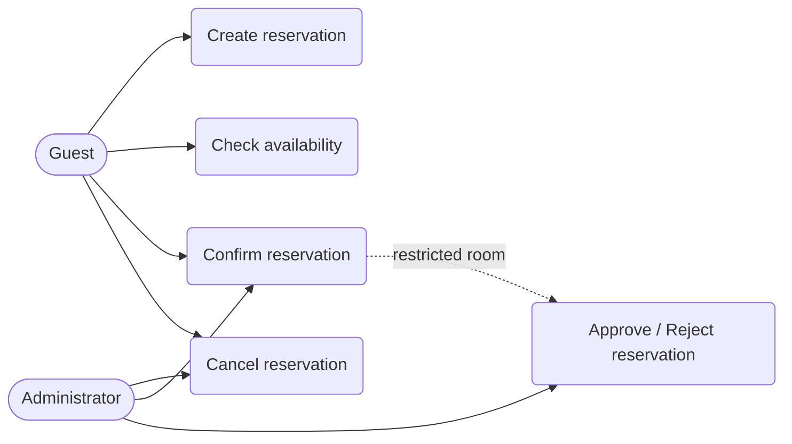
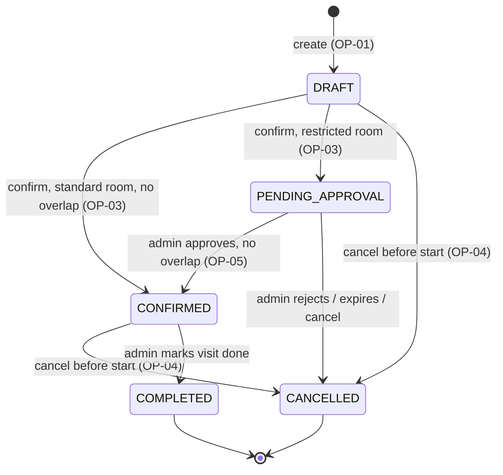

# Intent and Change

## Project Frame

### Reservation domain
We reserve **restaurant dining rooms** (tables) for a specific time window.

### Purpose
The system lets guests book a dining room online for a fixed seating time and lets restaurant staff manage those bookings. It exists to **eliminate double-booking**, give guests instant confirmation, and reduce manual work for staff.

### Users / Stakeholders
- **Guest:** Selects party size, date and seating time, enters contact details, and may cancel the booking.
- **Administrator (staff):** Views and manages reservations, floor plan, business hours and blocked dates; approves or rejects bookings for restricted rooms (from v0.2).

### Core concepts
- **Resource:** A dining room / table with name, capacity (max 5 seats) and an operational status.
- **Reservation:** The booking record with the room, date, start/end time, party size, guest details and state.
- **User:** The guest or administrator issuing the command.

### Core operations
- Create reservation
- Confirm reservation
- Cancel reservation
- Check availability

### Persistent state
- **Resource data:** ID, room name, capacity, active flag.
- **Reservation data:** ID, room ID, guest name/contact, date, start time, end time, party size, status string.
- Stored in Supabase PostgreSQL (`reservations`, `restaurant_tables`); browser `localStorage` is an offline fallback.

### State-changing operation
`DRAFT → CONFIRMED` (guest confirms, or automatically for standard rooms).
`CONFIRMED → CANCELLED` (guest or administrator revokes the slot).
`CONFIRMED → COMPLETED` (administrator marks the visit as done).

### Common business rule
Two CONFIRMED reservations for the same dining room must not overlap.

### Domain-specific business rule
A single reservation may have a maximum of **5 guests** (room capacity is capped at 5 seats). Seating times are fixed 90-minute slots per room.

### External / system boundary
**Supabase** (PostgreSQL, Auth, Row Level Security). The database trigger `prevent_table_double_booking` is the last line of defence against overlaps. No external notification service is used; the only outbound contact is `mailto:` links.

### Assumption
We assume Supabase responds fast enough (a few hundred milliseconds) that the availability check and the insert can be done synchronously inside the booking request without freezing the UI. If Supabase is not configured or a call fails, we assume the `localStorage` fallback is acceptable for a single-browser demo.

### Unknown
We do not yet know how to handle **abandoned DRAFT reservations** (a guest starts the booking wizard and never confirms), nor how the `localStorage` fallback should behave when two browsers book the same room.

### Selected future pressure
**Category:** C (Changeability)
**Concrete pressure:** Supporting additional bookable resources (e.g., a private event hall, outdoor terrace, or whole-restaurant buyouts) with different capacity limits and seating durations instead of the fixed 5 seats and 90 minutes.
**Why it is relevant:** The 5-guest limit and the 90-minute slot grid are currently hard-coded in the data service. New resource types need per-resource rules, so these rules must be separated from the booking flow.

### Stack Rationale
React 19 + TypeScript + Vite + Tailwind give a fast, typed single-page client that the whole team already knows. Supabase provides PostgreSQL, authentication, Row Level Security and a double-booking trigger without running our own server, which keeps setup small for a time-boxed course project. A `localStorage` fallback keeps the demo runnable without cloud setup. A Python + SQLAlchemy + SQLite spike (C01) was used to validate persistence and Pytest-based verification.

---

## Baseline v0.1 — Minimum Behavior Specification

### Shared Business Rules
- **BR-01 Interval semantics:** Time slots are evaluated as `[start, end)`. A reservation ending at 18:30 does not conflict with one starting at 18:30.
- **BR-02 Exclusive Resource invariant:** At no committed state may two CONFIRMED reservations overlap for the same dining room.
- **BR-03 Cancellation policy:** A DRAFT or CONFIRMED reservation can be cancelled by the guest or an administrator at any time strictly before its start time.
- **BR-04 Domain-specific limit:** A reservation has at most 5 guests (`1 ≤ party_size ≤ 5`).
- **BR-05 Seating grid:** Reservations use the room's 90-minute staggered slots (e.g., Room 1: 17:00–18:30, 18:30–20:00, 20:00–21:30; Room 2 starts at 17:15).

### OP-01 — Create Reservation
**Goal / user value:** Secure an initial time slot for a dining room.
**Trigger:** Guest submits a request for a room, date, time slot and party size.
**Observable requirement(s):** System records the intent but does not yet block the room for others.
**Preconditions:** Room exists and is active; `start < end`; slot lies on the room's 90-minute grid.
**Success postcondition:** One DRAFT reservation exists; no room allocation is committed yet.
**State change:** `[initial] → DRAFT`
**Referenced rules:** BR-01, BR-04, BR-05.

**Main success scenario**
1. Guest submits Room ID, Date, Start Time, End Time, Party Size and contact details.
2. System validates the room, the interval (BR-01) and the slot grid (BR-05).
3. System validates `party_size ≤ 5` (BR-04).
4. System creates a DRAFT reservation.
5. System returns the Reservation ID and state.

**Alternative / failure outcomes**
- Party size above 5 or below 1 → reject, no creation.
- Invalid interval (`start ≥ end`), off-grid slot or unknown room → reject, no creation.

**Verification examples**
- Valid slot + 4 guests → returns DRAFT.
- Request with 6 guests → rejected.

### OP-02 — Check Availability
**Goal / user value:** Discover which seating slots are open for a dining room.
**Trigger:** Guest (or the booking wizard) queries a room's availability for a date/interval.
**Observable requirement(s):** System reports whether the slot is free or blocked.
**Preconditions:** Room exists; valid interval.
**Success postcondition:** Accurate availability returned; no state changed.
**State change:** None.
**Referenced rules:** BR-01, BR-02.

**Main success scenario**
1. Guest requests availability for a Room ID and interval.
2. System looks for overlapping CONFIRMED reservations.
3. System returns AVAILABLE or UNAVAILABLE (shown in the UI as a selectable or disabled slot).

**Alternative / failure outcomes**
- Unknown Room ID → error / 404.

**Verification examples**
- Interval overlaps an existing CONFIRMED reservation → UNAVAILABLE.
- Interval overlaps only a DRAFT reservation → AVAILABLE.

### OP-03 — Confirm Reservation
**Goal / user value:** Finalize the booking and block the room for other guests.
**Trigger:** Guest confirms in the wizard (executed automatically right after creation for standard rooms), or administrator confirms.
**Observable requirement(s):** The reservation becomes active and blocks future availability checks for that time.
**Preconditions:** Reservation exists in DRAFT state; room is active.
**Success postcondition:** `Reservation.status = CONFIRMED`; exclusive-resource invariant still holds.
**State change:** `DRAFT → CONFIRMED`
**Referenced rules:** BR-02, BR-04.

**Main success scenario**
1. Guest (or system) confirms a DRAFT reservation ID.
2. System checks for overlapping CONFIRMED reservations (BR-02).
3. System updates the state to CONFIRMED.
4. Reservation now blocks the room.

**Alternative / failure outcomes**
- Overlap detected (including a concurrent booking caught by the database trigger) → reject with the message *"Double-booking is not possible: This dining room is already booked for this date and time."*; reservation stays DRAFT.
- Invalid source state (already CANCELLED) → reject.

**Verification examples**
- No overlap → state becomes CONFIRMED.
- Overlap with another CONFIRMED slot → confirmation rejected.
- Two concurrent confirmations for the same slot → exactly one reaches CONFIRMED.

### OP-04 — Cancel Reservation
**Goal / user value:** Release a booked or pending room so others can use it.
**Trigger:** Guest or administrator requests cancellation.
**Observable requirement(s):** The reservation no longer blocks availability.
**Preconditions:** Reservation is in DRAFT or CONFIRMED state.
**Success postcondition:** `Reservation.status = CANCELLED`.
**State change:** `DRAFT → CANCELLED` or `CONFIRMED → CANCELLED`
**Referenced rules:** BR-03.

**Main success scenario**
1. User submits a cancel request for a reservation ID.
2. System verifies the current time is strictly before the start time (BR-03).
3. System updates the state to CANCELLED.

**Alternative / failure outcomes**
- Current time is past the start time → reject cancellation.
- Repeated cancellation → idempotent (success, no new change).

**Verification examples**
- Cancellation 1 hour before start → CANCELLED.
- Cancellation 5 minutes after start → rejected.

---

## Baseline v0.2 — Change: Approval Workflow

### 1. Change Impact Analysis

**Changed condition:** Certain special dining rooms (e.g., rooms prefixed `VIP_`, private dining, or flagged `requires_approval`) need explicit administrator approval before a reservation can become CONFIRMED. Approval may be delayed, rejected, or expire if not handled before the start time.

**Affected requirements / slices**
- **OP-03 (Confirm Reservation):** For an approval-required room the system cannot move DRAFT directly to CONFIRMED; it moves the reservation to `PENDING_APPROVAL`. Standard rooms keep the direct path (and the guest still gets instant confirmation).
- **OP-04 (Cancel) and BR-03:** Extended so guests and administrators can also cancel reservations in `PENDING_APPROVAL`.
- **Admin dashboard (`ReservationsView`):** Must list pending requests and offer approve / reject actions.

**Unaffected requirements / slices + reason**
- **OP-01 (Create):** Still yields an uncommitted DRAFT regardless of room type.
- **OP-02 (Check Availability):** Only CONFIRMED reservations block a slot; DRAFT and `PENDING_APPROVAL` do not block it until approved.
- **BR-01, BR-02, BR-05:** Interval semantics, the no-overlap invariant and the seating grid hold for every room type.
- **BR-04 (max 5 guests):** It is a per-reservation limit, so pending requests do not change how it is calculated.

**New actor / operation**
- **Actor:** Administrator gains formal approval / rejection duties.
- **Operation:** OP-05 — Approve / Reject Reservation.

**Changed rules / state semantics**
- New state `PENDING_APPROVAL` in the reservation lifecycle.
- If `now ≥ start_time` while still `PENDING_APPROVAL`, the request expires and moves to CANCELLED.

**New verification examples**
- Confirming a standard room (Room 1): `DRAFT → CONFIRMED`.
- Confirming a restricted room (`VIP_Room1`): `DRAFT → PENDING_APPROVAL`.
- Administrator approves a pending reservation with no overlap: `PENDING_APPROVAL → CONFIRMED`.
- Administrator rejects a pending reservation: `PENDING_APPROVAL → CANCELLED`.

**Architecture driver(s) for the next step**
- **State machine and guard complexity:** Booking rules, status transitions (`DRAFT → CONFIRMED` vs `PENDING_APPROVAL`) and storage calls (Supabase, `localStorage`) currently live together in `src/lib/data-service.ts`. The approval branch makes this brittle; domain rules must be separated from the storage layer (see C05: `ReservationPolicy`, `ReservationService`, `ReservationRepository`).
- **Concurrency and locking:** A longer approval delay widens the race window where two requests wait for the same slot. Approval must re-check overlap atomically; the Postgres trigger stays as the final guard.

### 2. New Operation Slice: OP-05 — Approve / Reject Reservation

**Goal / user value:** Let an administrator review, approve or reject pending requests for restricted dining rooms.
**Trigger:** Administrator submits a decision for a reservation in `PENDING_APPROVAL`.
**Observable requirement(s):** If approved, the reservation becomes CONFIRMED and blocks the room. If rejected or expired, it becomes CANCELLED and the slot stays free.
**Preconditions:** Actor is an administrator; reservation is in `PENDING_APPROVAL`; current time is strictly before `start_time`.
**Success postcondition:** Reservation is CONFIRMED (approve) or CANCELLED (reject); exclusive-resource invariant holds.
**State change:** `PENDING_APPROVAL → CONFIRMED` or `PENDING_APPROVAL → CANCELLED`
**Referenced rules:** BR-01, BR-02.

**Main success scenario (approval)**
1. Administrator submits an *approve* decision for a reservation ID.
2. System verifies the reservation is `PENDING_APPROVAL` and not expired (`now < start_time`).
3. System checks for overlapping CONFIRMED reservations on the same room (BR-02).
4. System updates the state to CONFIRMED.
5. The dashboard shows the new status (guest sees it on their confirmation view or contact link).

**Alternative / failure outcomes**
- *Reject* decision → state becomes CANCELLED.
- Overlapping CONFIRMED reservation already exists → reject approval with a conflict error; reservation stays `PENDING_APPROVAL` (or the administrator cancels it).
- Approval attempted after `start_time` → reject and move to CANCELLED.
- Reservation not in `PENDING_APPROVAL` → reject as invalid state.
- Non-administrator attempts the action → reject (authorization).

**Verification examples**
- Approve a valid pending slot with no overlap → CONFIRMED.
- Reject a pending slot → CANCELLED.
- Approve a pending slot after another reservation was confirmed for that time → rejected with conflict.

### 3. Updated Visual Models (Baseline v0.2)

**Use-case / actor-goal view**

**Reservation lifecycle statechart**

